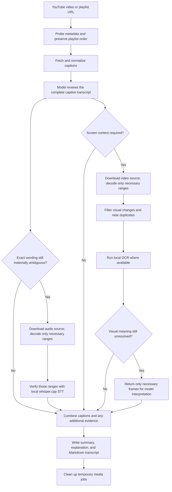

# YouTube Deep Analyzer

Local-first YouTube analysis for Codex, the ChatGPT desktop app, and Claude Code.

YouTube Deep Analyzer turns permitted public YouTube videos and playlists into a concise summary, a structured explanation, and a timestamped Markdown transcript. It uses captions as the primary evidence, checks short audio ranges with local speech-to-text only when exact wording matters, and inspects only the visual ranges that the transcript cannot explain.

No API key is required. The repository does not operate a backend service and does not receive your URLs, media, transcripts, or generated artifacts.

## Contents

- [What you get](#what-you-get)
- [Quick start](#quick-start)
- [Example requests](#example-requests)
- [How it works](#how-it-works)
- [Evidence and resource policy](#evidence-and-resource-policy)
- [Requirements and compatibility](#requirements-and-compatibility)
- [Runtime downloads and local data](#runtime-downloads-and-local-data)
- [Troubleshooting](#troubleshooting)
- [Development and validation](#development-and-validation)
- [Distribution](#distribution)
- [Safety, privacy, and limitations](#safety-privacy-and-limitations)

## What you get

- **Video and playlist analysis:** handles one public video or an ordered playlist.
- **Caption-first transcripts:** downloads and normalizes an available manual or automatic caption track before requesting media.
- **Selective local STT:** verifies only short, materially ambiguous phrases such as names, numbers, negations, or technical terms.
- **Targeted visual inspection:** examines charts, slides, code, equations, demonstrations, and other necessary screen context without scanning every frame by default.
- **Local duplicate filtering and OCR:** removes near-duplicate frames and attempts local OCR before sending a frame to the image model.
- **Structured artifacts:** returns a summary first, then a complete explanation, followed by links to Markdown analysis and transcript files.
- **Transport diagnostics:** reports the failing stage, HTTP status, retryability, retry history, language attempts, and correlation ID when YouTube rejects a request.

This project is deliberately not a private-video downloader, restriction bypass, or full-frame surveillance tool.

## Quick start

The public marketplace is hosted at `hyb9579/YoutubeDeepAnalyzer`.

### Codex and the ChatGPT desktop app

Add the Git-backed marketplace and install the plugin:

```sh
codex plugin marketplace add hyb9579/YoutubeDeepAnalyzer \
  --ref main \
  --sparse .agents/plugins \
  --sparse plugins

codex plugin add youtube-deep-analyzer@youtube-deep-analyzer
```

Alternatively, add the repository from the Plugins Directory in the ChatGPT desktop app and install **YouTube Deep Analyzer** from the `YouTube Deep Analyzer` marketplace.

Restart the app if requested, then start a **new task** so the bundled skill and `youtube-media` MCP tools are registered in that task.

For a full checkout, omit the two `--sparse` options. See the official [OpenAI plugin packaging guide](https://developers.openai.com/plugins/build/plugins) for marketplace behavior.

### Claude Code

```text
/plugin marketplace add hyb9579/YoutubeDeepAnalyzer
/plugin install youtube-deep-analyzer@youtube-deep-analyzer
```

Start a new Claude Code session after installation. If you updated an existing installation, reload or reinstall the plugin before starting the new session.

To receive the MCP startup fix in version 1.3.1, refresh the marketplace and update the installed plugin:

```sh
claude plugin marketplace update youtube-deep-analyzer
claude plugin update youtube-deep-analyzer@youtube-deep-analyzer
```

Then restart Claude Code and start a new session. Editing an existing installation cache is not required.

### Local checkout

From a cloned copy, Codex can use the repository root as a local marketplace:

```sh
codex plugin marketplace add /absolute/path/to/youtube-deep-analyzer-github
codex plugin add youtube-deep-analyzer@youtube-deep-analyzer
```

## Example requests

The plugin is selected automatically when a request includes a YouTube video or playlist and asks for analysis, explanation, notes, or a transcript.

```text
Summarize this video first, then explain all of its content with timestamps:
https://www.youtube.com/watch?v=VIDEO_ID
```

```text
Analyze this playlist in its displayed order. Create one result per video and a final
playlist-wide synthesis. Preserve the order even if processing can run in parallel:
https://www.youtube.com/playlist?list=PLAYLIST_ID
```

```text
Use the available captions only. Do not download audio or inspect frames unless I ask.
https://www.youtube.com/watch?v=VIDEO_ID
```

```text
Explain the chart shown around 12:30. Use the captions for context and inspect only the
smallest necessary visual range.
https://www.youtube.com/watch?v=VIDEO_ID
```

Typical response order:

1. concise summary and essential takeaways;
2. structured, timestamped explanation of the full content;
3. analysis artifact link;
4. caption transcript artifact link;
5. disclosure of whether selective STT or visual inspection was used and why.

## How it works



The STT and visual branches are independent. Complete any required evidence checks before writing the artifacts. If no suitable captions are available, ask the user before starting full audio transcription or visual-only analysis.

### Videos

1. `youtube_probe` validates the URL and reads metadata and caption availability.
2. `youtube_prepare_transcript_bundle` fetches and normalizes one caption track without downloading audio or video.
3. The model reads the complete normalized transcript and identifies unresolved lexical or visual questions.
4. `youtube_verify_caption_ranges` may download audio and run local STT on bounded ranges only when an exact word materially changes the explanation.
5. `youtube_prepare_visual_ranges` may download the video source, decode only the requested ranges, filter visually redundant candidates, and run local OCR.
6. Only still-unresolved selected frames are returned to the model for image interpretation.
7. The plugin writes the requested Markdown artifacts before deleting temporary media.

### Playlists

The displayed playlist position is recorded before analysis. Independent videos may be processed with bounded parallelism, but final results are assembled by canonical playlist position rather than completion order. Sequential or instructional series remain sequential. Unavailable items keep their original positions in the playlist index.

## Evidence and resource policy

| Evidence | Default behavior | Used when | Model-token impact |
|---|---|---|---:|
| Metadata | Always | Identifying the source and preserving playlist order | Low |
| Captions | Always when available | Primary transcript and explanation evidence | Main text-token cost |
| Local STT | Optional and range-bounded | Exact audible wording remains materially ambiguous | No inference tokens; local CPU time |
| Local frame filtering | Optional and targeted | Transcript proves that screen context is necessary | No model tokens; local decode/CPU time |
| Local OCR | Optional and targeted | Selected frames may contain explanatory text | No model tokens; local CPU time |
| Image-model inspection | Last resort | OCR and transcript still cannot resolve visual meaning | Image tokens for selected frames only |

The visual path is independent of STT. A chart can be inspected without transcribing audio, and an ambiguous spoken term can be checked without downloading video frames.

The normal workflow does **not**:

- transcribe the full audio merely because captions are automatic;
- analyze speaker identity, emotion, pitch, laughter, music, or delivery;
- scan every frame merely because a video was provided;
- replace reliable captions with a complete local STT transcript;
- silently reorder a playlist.

## Requirements and compatibility

### Required

- Python 3.10 or newer;
- `pip` available to that Python installation;
- a POSIX-compatible `sh` launcher;
- network access to YouTube and, during first-run setup, PyPI.

FFmpeg is supplied through the pinned `imageio-ffmpeg` runtime dependency; a separate system FFmpeg installation is not normally required.

### Optional

- **Node.js:** recommended for current YouTube JavaScript challenge compatibility. The runtime reports whether it is available.
- **`whisper-cli`:** required only when selective local STT is justified or the user explicitly requests a full local transcription.
- **`swiftc` on macOS:** enables the Apple Vision OCR backend. Other platforms continue without that local OCR backend and may require selected-frame interpretation instead.

### Platform matrix

| Environment | Support | Notes |
|---|---:|---|
| macOS | Full | Apple Vision OCR; optional Homebrew `whisper-cpp` |
| Linux | Partial | Caption and media paths work; install `whisper-cli` for selective STT; no Apple Vision OCR |
| Windows via WSL | Partial | Uses the POSIX launcher; no Apple Vision OCR |
| Native Windows | Not packaged | The current MCP launcher uses `sh` |
| ChatGPT universal public directory | Requires additional cloud work | This repository ships a local `stdio` MCP server, not a public HTTPS MCP service |

## Runtime downloads and local data

The Git repository stays small. Runtime components are installed into a user cache rather than committed to the plugin:

```text
plugin files
   |
   +-- first MCP launch --> pinned Python packages from PyPI
   +-- bounded check ----> verified stable yt-dlp overlay from PyPI
   +-- only if STT runs -> checksum-verified whisper.cpp model
   +-- per request ------> captions and selected media in a local job directory
```

- Dependencies are keyed by the SHA-256 digest of `requirements.lock`.
- The `yt-dlp` updater checks at most once every 24 hours and preserves the pinned bundled version as a fallback.
- The speech model is downloaded only when STT is actually requested and is cached after checksum verification.
- Per-video media is temporary and should be deleted after requested artifacts are written unless the user asks to retain it.
- Generated Markdown files remain wherever the host saves them.

No YouTube, OpenAI, or Anthropic API key is required by the plugin itself.

## Troubleshooting

### Claude reports CONNECTION_CLOSED before the server starts

Version 1.3.0 could resolve the launcher to `./scripts/start_mcp.sh` in the session working directory. A stderr message saying that file does not exist indicates a launch-path failure before Python starts. Update to 1.3.1 using the commands above, restart Claude Code, and retry in a new session.

The shared `.mcp.json` launches relative to the installed plugin directory for Codex. The Claude manifest overrides that server with `${CLAUDE_PLUGIN_ROOT}/scripts/start_mcp.sh`, so Claude sessions do not depend on their working directory.

### The plugin or `youtube-media` tools are missing

Plugin tools are registered when a task or session starts. After installing or updating the plugin:

1. confirm that **YouTube Deep Analyzer** is installed and enabled;
2. reload or restart the host if requested;
3. start a new Codex task or Claude Code session;
4. retry the request there.

Downloaded media already present on disk does not make it visible to the model. The `youtube-media` MCP tools must be registered in the active task.

### Captions fail with HTTP 429

YouTube has rate-limited the request. The transport layer honors `Retry-After` when available; otherwise it uses jittered 5, 15, and 45 second backoffs. Requests for the same video are serialized so caption and media downloads do not compete with each other. If all attempts fail, retry later or from a network with a different public egress policy.

### Media fails with HTTP 403

Metadata may succeed while the media CDN rejects the byte request. The plugin re-extracts the public media URL and retries once, then returns structured diagnostics. It does not add cookies, credentials, login bypasses, or restriction-evasion behavior. Updating `yt-dlp` may help compatibility, but a 403 is not always a version problem.

### Selective STT is unavailable

Caption-only analysis still works. Install whisper.cpp so `whisper-cli` is executable, then start a new task or session. On macOS with Homebrew:

```sh
brew install whisper-cpp
```

The model is downloaded only on the first justified STT request.

### Local OCR is unavailable

Apple Vision OCR requires macOS and `swiftc`. On unsupported systems, the plugin records that local OCR is unavailable and may return only the minimum unresolved frames for model interpretation.

### No suitable captions exist

The plugin does not silently download and transcribe the full audio. It asks whether the user wants an explicit full local transcription or visual-only analysis.

## Development and validation

Clone the repository, then run the distribution check from its root:

```sh
python3 --version
python3 scripts/validate_distribution.py
```

Prepare an isolated test runtime without modifying the normal cache, then run the unit and MCP registration tests:

```sh
RUNTIME_PATH="$(YOUTUBE_DEEP_ANALYZER_DEPENDENCY_CACHE=/tmp/yda-runtime-test \
  YOUTUBE_DEEP_ANALYZER_AUTO_UPDATE=0 \
  python3 plugins/youtube-deep-analyzer/scripts/bootstrap_runtime.py --print-path)"

PYTHONPATH="$RUNTIME_PATH" python3 -m unittest discover \
  -s plugins/youtube-deep-analyzer/scripts \
  -p 'test_*.py'

PYTHONPATH="$RUNTIME_PATH" YOUTUBE_DEEP_ANALYZER_BASE_RUNTIME="$RUNTIME_PATH" \
  python3 plugins/youtube-deep-analyzer/scripts/smoke_test_mcp.py --host codex

PYTHONPATH="$RUNTIME_PATH" YOUTUBE_DEEP_ANALYZER_BASE_RUNTIME="$RUNTIME_PATH" \
  python3 plugins/youtube-deep-analyzer/scripts/smoke_test_mcp.py --host claude
```

The smoke checks initialize MCP and call runtime status tools. The Claude check models the documented plugin-root substitution and launches from an unrelated directory; it does not replace an end-to-end test in the Claude desktop app.

Claude Code can additionally validate its marketplace schema:

```sh
claude plugin validate .
```

See [CONTRIBUTING.md](CONTRIBUTING.md) before changing transport, transcript, STT, OCR, or visual-filtering behavior.

## Repository layout

```text
.
├── .agents/plugins/marketplace.json       # Codex/ChatGPT marketplace catalog
├── .claude-plugin/marketplace.json        # Claude Code marketplace catalog
├── .github/workflows/validate.yml         # CI validation
├── docs/
│   ├── ARCHITECTURE.md
│   ├── DISTRIBUTION.md
│   ├── PRIVACY.md
│   └── TERMS.md
├── plugins/youtube-deep-analyzer/
│   ├── .codex-plugin/plugin.json          # Codex compatibility manifest
│   ├── .claude-plugin/plugin.json         # Claude plugin manifest
│   ├── .mcp.json                          # local youtube-media MCP registration
│   ├── requirements.lock                  # fully pinned Python runtime
│   ├── skills/analyze-youtube-video/      # analysis policy and output contract
│   └── scripts/                           # transport, STT, OCR, MCP, and tests
└── scripts/validate_distribution.py
```

## Distribution

| Target | Included entry point | Publication model |
|---|---|---|
| GitHub / Codex | `.agents/plugins/marketplace.json` | Users add `hyb9579/YoutubeDeepAnalyzer` |
| GitHub / Claude Code | `.claude-plugin/marketplace.json` | Users add `hyb9579/YoutubeDeepAnalyzer` |
| ChatGPT workspace | Installed personal plugin | A workspace admin publishes it to selected roles |
| ChatGPT universal directory | Not directly deployable from this repository | Requires review and a production HTTPS MCP service |
| Claude official marketplace | Not automatic | Requires Anthropic's separate submission and review |

Installing from GitHub does not automatically submit the plugin to either vendor's official public directory. See [docs/DISTRIBUTION.md](docs/DISTRIBUTION.md) for release and marketplace details.

## Safety, privacy, and limitations

- Process only public videos or content you are authorized to access.
- The plugin does not inject cookies or implement login, DRM, paywall, age, regional, or other restriction bypasses.
- YouTube can change its delivery behavior or reject requests even when a video is public.
- Captions and STT can contain errors. The final artifact records evidence sources, corrections, and unresolved uncertainty.
- The repository publisher operates no backend and receives no processed content through this software.
- The installed AI host processes prompts and returned tool data under that host's own terms and privacy policy.

Read the complete [Privacy Notice](docs/PRIVACY.md), [Terms](docs/TERMS.md), [Security Policy](SECURITY.md), and [Architecture](docs/ARCHITECTURE.md).

## License

MIT. See [LICENSE](LICENSE).
